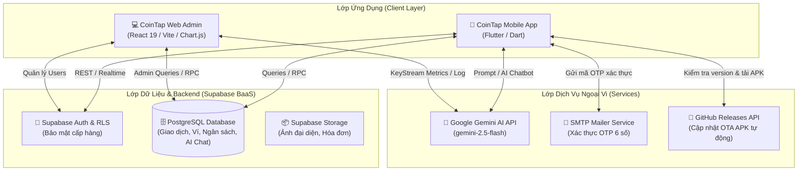

<div align="center">

# 💰 CoinTap
### Hệ Thống Quản Lý Tài Chính Cá Nhân Thông Minh & Cổng Quản Trị AI

[](https://flutter.dev)
[](https://dart.dev)
[](https://react.dev)
[](https://vitejs.dev)
[](https://supabase.com)
[](https://ai.google.dev)
[](https://github.com/Lnnam123/project_24ct1_lenhatnam/releases)
[](LICENSE)

*Đồ án môn học: **Công Nghệ Phần Mềm** | Sinh viên thực hiện: **Lê Nhật Nam** (Lớp: **24CT1**)*

[🌟 Giới Thiệu](#-giới-thiệu-dự-án) •
[🏛️ Kiến Trúc](#️-kiến-trúc-hệ-thống) •
[✨ Tính Năng](#-tính-năng-nổi-bật) •
[📂 Cấu Trúc Dự Án](#-cấu-trúc-thư-mục) •
[🗄️ Cơ Sở Dữ Liệu](#️-cơ-sở-dữ-liệu-supabase) •
[🚀 Cài Đặt & Khởi Chạy](#-hướng-dẫn-cài-đặt--khởi-chạy) •
[🔄 Cập Nhật OTA](#-quy-trình-phát-hành-cập-nhật-ota) •
[📑 Tài Liệu](#-tài-liệu-đồ-án-liên-quan)

---

</div>

## 🌟 Giới Thiệu Dự Án

**CoinTap** là một giải pháp quản lý tài chính cá nhân hiện đại theo mô hình đa nền tảng, giải quyết triệt để vấn đề theo dõi dòng tiền hàng ngày của người dùng nhờ sự hỗ trợ của **Trí tuệ nhân tạo (Google Gemini AI)** cùng hệ sinh thái quản trị thông minh:

1. **📱 Ứng dụng Di động CoinTap Mobile (Flutter)**:
   - Giao diện người dùng hiện đại, tối ưu trải nghiệm (UX) với phong cách thiết kế mượt mà, hỗ trợ Dark/Light Theme.
   - Quản lý giao dịch thu/chi, chuyển tiền giữa các ví, thiết lập hạn mức ngân sách và phân tích dòng tiền chuyên sâu bằng biểu đồ trực quan.
   - Tích hợp **Trợ lý Tài chính AI (Gemini AI)**: Nút chat nổi thông minh, bóc tách hóa đơn tự động và tương tác giọng nói.
   - Cơ chế cập nhật ứng dụng tự động qua giao thức **OTA (Over-The-Air)** trực tiếp từ GitHub Releases.

2. **💻 Cổng Quản trị CoinTap Web Admin (React + Vite)**:
   - Dành riêng cho Quản trị viên quản lý toàn bộ hệ sinh thái: giám sát người dùng, phê duyệt/khóa tài khoản, phát thông báo Broadcast toàn hệ thống.
   - Quản lý danh mục thu/chi và thư viện biểu tượng chuẩn **Google Material Symbols** đồng bộ thời gian thực sang Mobile.
   - Bảng điều khiển giám sát AI (**KeyStream Metrics**): Theo dõi số lượt gọi API, lượng tiêu thụ Token, phân bổ model và ước tính chi phí vận hành.

---

## 🏛️ Kiến Trúc Hệ Thống

Dự án áp dụng mô hình kiến trúc phân tầng kết hợp **BaaS (Backend-as-a-Service)** trên nền tảng Supabase:



---

## ✨ Tính Năng Nổi Bật

### 1. Ứng Dụng Di Động (CoinTap Mobile)
- **⚡ Ghi Chép Thu Chi Siêu Nhanh**:
  - Giao diện nhập liệu thông minh với bàn phím tự format hàng nghìn theo thời gian thực (`CurrencyInputFormatter`).
  - Hỗ trợ phân loại danh mục, chọn ví nguồn/đích, chọn ngày giờ trực quan và đính kèm ghi chú.
  - Cảnh báo tức thì nếu số tiền chi tiêu vượt quá số dư khả dụng trong ví.
- **🤖 Trợ Lý Tài Chính Thông Minh (Google Gemini AI)**:
  - Nút bấm AI nổi (`NutAIChatFloating`) luôn sẵn sàng hỗ trợ người dùng trên màn hình chính.
  - Tư vấn kế hoạch tiết kiệm, phân tích thói quen tiêu xài dựa trên lịch sử giao dịch thực tế.
  - Hỗ trợ mô phỏng bóc tách giao dịch từ hóa đơn chụp ảnh hoặc giọng nói.
- **📊 Báo Cáo & Phân Tích Tài Chính Đa Chiều**:
  - Biểu đồ tròn phân bổ chi tiêu theo danh mục.
  - Biểu đồ cột dòng tiền ròng theo tuần, tháng và năm.
  - Bộ lọc nâng cao theo ví, danh mục và khoảng thời gian tùy chọn.
- **👛 Quản Lý Đa Tài Khoản & Ví Tiền**:
  - Hỗ trợ nhiều loại ví: Tiền mặt, Thẻ tín dụng, Tài khoản ngân hàng, Ví điện tử (MoMo, ZaloPay,...).
  - Chuyển tiền qua lại giữa các ví kèm ghi nhận lịch sử biến động số dư.
- **🎯 Quản Lý Hạn Mức Ngân Sách**:
  - Đặt ngân sách chi tiêu hàng tháng theo từng danh mục.
  - Đo lường tiến độ chi tiêu theo thang phần trăm (xanh: an toàn, vàng: cảnh báo, đỏ: vượt ngưỡng).
- **🔒 Xác Thực Đa Lớp & Bảo Mật Cao**:
  - Đăng nhập bảo mật bằng Email/Mật khẩu hoặc **Mã PIN 6 số cá nhân**.
  - Đăng nhập sinh trắc học vân tay / Face ID thông qua thư viện `local_auth`.
  - Khôi phục mật khẩu thông qua mã xác thực **OTP 6 số gửi qua Email**.
- **🔄 Cập Nhật Ứng Dụng Tự Động (OTA Updates)**:
  - Tự động kiểm tra bản cập nhật mới nhất từ GitHub Releases khi mở app hoặc trong menu Cài đặt.
  - Tải trực tiếp file `.apk` và mở trình cài đặt hệ thống không cần qua CH Play.

### 2. Cổng Quản Trị Hệ Thống (CoinTap Web Admin)
- **📈 Dashboard Tổng Quan**:
  - Hiển thị các chỉ số KPI theo thời gian thực: Tổng người dùng, tài khoản hoạt động, số phiên hội thoại AI, lượng tokens tiêu thụ.
  - Kiểm tra tình trạng sức khỏe hạ tầng hệ thống (Health Check) đối với Supabase, Gemini AI và Push Service.
- **👥 Quản Lý Người Dùng & Phân Quyền**:
  - Tra cứu danh sách người dùng với đầy đủ thông tin, trạng thái tài khoản.
  - Thao tác khóa (*Banned*), tạm ngưng (*Suspended*) hoặc kích hoạt lại người dùng.
- **🏷️ Quản Lý Danh Mục & Kho Biểu Tượng**:
  - Thêm, sửa, xóa danh mục chi tiêu/thu nhập dùng chung cho toàn bộ hệ thống.
  - Tích hợp bộ sưu tập biểu tượng chuẩn **Google Material Symbols**, đồng bộ tự động sang Mobile App.
- **🧠 Giám Sát Chi Phí & Nhật Ký Gemini AI**:
  - Bảng thống kê **KeyStream Metrics**: Lưu lượng truy vấn 7 ngày gần nhất, tỷ lệ phân bổ model (`gemini-2.5-flash`), ước tính chi phí theo USD và VNĐ.
  - Xem chi tiết từng phiên hội thoại giữa người dùng và AI nhằm cải thiện chất lượng phản hồi.
- **📢 Phát Thông Báo Hệ Thống (Broadcast)**:
  - Gửi thông báo bảo trì, tin tức sự kiện hoặc cập nhật phiên bản đến toàn bộ người dùng.

---

## 📂 Cấu Trúc Thư Mục

```text
project_24ct_lenhatnam/
├── .env                                  # Biến môi trường bảo mật (API Keys, Supabase URL)
├── .env.example                          # File mẫu cấu hình biến môi trường
├── pubspec.yaml                          # Quản lý thư viện và phiên bản Flutter (v1.5.3+11)
├── android/                              # Cấu hình Native Android, Gradle và quyền hệ thống
├── database/                             # Tập lệnh SQL khởi tạo và cấu trúc CSDL Supabase
│   ├── database_tieng_viet.sql           # Schema CSDL chuẩn hóa toàn bộ tiếng Việt
│   ├── schema.sql                        # Schema gốc khởi tạo
│   ├── schema_admins.sql                 # Bảng quản trị viên và quyền hạn
│   ├── schema_ai_chat.sql                # Bảng lưu trữ phiên và tin nhắn AI Chat
│   └── supabase_database_export.sql      # Dữ liệu xuất mẫu
├── lib/                                  # MÃ NGUỒN CHÍNH FLUTTER (MÔ HÌNH PHÂN TẦNG FRONTEND - BACKEND)
│   ├── main.dart                         # Điểm khởi chạy ứng dụng & điều phối luồng chính
│   │
│   ├── frontend/                         # TẦNG GIAO DIỆN & TRẢI NGHIỆM NGƯỜI DÙNG (PRESENTATION LAYER)
│   │   ├── chu_de/                       # Hệ thống thiết kế màu sắc và chủ đề (Design System / Theme)
│   │   │   └── mau_sac.dart              # Bảng màu chủ đạo, chế độ màu sáng/tối
│   │   ├── man_hinh/                     # Các màn hình người dùng (Views / Screens)
│   │   │   ├── bao_cao.dart              # Màn hình biểu đồ báo cáo tài chính
│   │   │   ├── cai_dat.dart              # Cài đặt, bảo mật, thông tin phiên bản
│   │   │   ├── chi_tiet_giao_dich.dart   # Chi tiết và lịch sử chỉnh sửa giao dịch
│   │   │   ├── chi_tiet_phan_tich.dart   # Phân tích sâu dòng tiền theo danh mục
│   │   │   ├── chi_tiet_thu_chi.dart     # Danh sách phân loại các khoản thu chi
│   │   │   ├── chi_tiet_vi.dart          # Quản lý số dư và giao dịch theo từng ví
│   │   │   ├── dang_ky.dart              # Đăng ký tài khoản người dùng mới
│   │   │   ├── dang_nhap.dart            # Đăng nhập bằng Email / Mật khẩu
│   │   │   ├── dang_nhap_nhanh.dart      # Đăng nhập nhanh bằng mã PIN cá nhân / Sinh trắc học
│   │   │   ├── dat_lai_mat_khau.dart     # Đặt lại mật khẩu mới sau khi xác thực OTP
│   │   │   ├── dieu_khoan.dart           # Điều khoản dịch vụ và chính sách bảo mật
│   │   │   ├── doi_mat_khau.dart         # Đổi mật khẩu trong tài khoản
│   │   │   ├── quan_ly_danh_muc.dart     # Quản lý danh mục cá nhân hóa
│   │   │   ├── quan_ly_ngan_sach.dart    # Thiết lập và theo dõi hạn mức ngân sách
│   │   │   ├── quen_mat_khau.dart        # Yêu cầu gửi OTP quên mật khẩu
│   │   │   ├── them_danh_muc.dart        # Thêm mới danh mục kèm chọn icon phong phú
│   │   │   ├── thong_bao.dart            # Hộp thư thông báo hệ thống
│   │   │   ├── thong_tin_ca_nhan.dart    # Cập nhật thông tin và hồ sơ cá nhân
│   │   │   ├── tong_quan.dart            # Dashboard tổng quan tài chính (Trang chủ)
│   │   │   ├── tro_ly_ai.dart            # Màn hình trò chuyện chuyên sâu với Gemini AI
│   │   │   ├── vi_tien.dart              # Quản lý danh sách các tài khoản ví
│   │   │   └── xac_thuc_otp.dart         # Xác minh mã OTP 6 chữ số
│   │   └── thanh_phan/                   # Các Widget & Modal tái sử dụng (Components)
│   │       ├── modal_doi_danh_muc.dart   # Bottom sheet đổi danh mục nhanh
│   │       ├── modal_ngan_sach.dart      # Modal thêm / sửa ngân sách
│   │       ├── modal_quan_ly_vi_tien.dart# Modal thêm / sửa ví tiền
│   │       ├── modal_them_giao_dich.dart # Modal thêm giao dịch đa chức năng
│   │       ├── nut_ai_chat_floating.dart # Nút AI nổi di chuyển tự do trên màn hình
│   │       └── skeleton_loading.dart     # Hiệu ứng Shimmer khi tải dữ liệu
│   │
│   └── backend/                          # TẦNG DỮ LIỆU, DỊCH VỤ & NGHIỆP VỤ (DATA & BUSINESS LOGIC)
│       ├── database/                     # Quản lý truy vấn và giao tiếp cơ sở dữ liệu Supabase
│       │   └── database_service.dart     # Dịch vụ CRUD trung tâm (Auth, Wallets, Transactions, Budgets, AI...)
│       ├── models/                       # Các mô hình thực thể dữ liệu (Data Models / Entities)
│       │   └── models.dart               # NguoiDung, GiaoDich, ViTien, DanhMuc, NganSach, ThongBao
│       ├── services/                     # Tầng dịch vụ hệ thống và ngoại vi
│       │   ├── email_service.dart        # Gửi mã OTP xác thực qua Email (SMTP Gmail)
│       │   ├── notification_service.dart # Quản lý, đồng bộ và tự động tạo thông báo thông minh
│       │   ├── time_service.dart         # Lấy thời gian chuẩn Internet chống gian lận chỉnh giờ
│       │   └── update_service.dart       # Kiểm tra và cập nhật ứng dụng tự động OTA từ GitHub
│       └── utils/                        # Tiện ích bổ trợ và helper
│           └── icon_helper.dart          # Bộ bản đồ ánh xạ biểu tượng Google Material Symbols
├── test/                                 # MÃ NGUỒN KIỂM THỬ TỰ ĐỘNG (AUTOMATED TESTING)
│   └── widget_test.dart                  # Kiểm thử tự động giao diện màn hình Đăng nhập (Widget Test)
├── web_admin/                            # MÃ NGUỒN CỔNG QUẢN TRỊ ADMIN (REACT + VITE)
│   ├── src/
│   │   ├── dich_vu/                      # API kết nối Supabase Client
│   │   │   ├── api.js                    # Nghiệp vụ lấy số liệu, quản lý User, danh mục
│   │   │   └── supabase.js               # Khởi tạo kết nối Supabase JS
│   │   ├── man_hinh/                     # Các trang quản trị viên
│   │   │   ├── DangNhap.jsx              # Đăng nhập trang Admin
│   │   │   ├── DanhMuc.jsx               # Quản lý danh mục & kho icon Material Symbols
│   │   │   ├── NguoiDung.jsx             # Quản lý trạng thái và danh sách người dùng
│   │   │   ├── NhatKyAI.jsx              # Giám sát KeyStream và lịch sử AI
│   │   │   ├── QuanTriVien.jsx           # Phân quyền danh sách tài khoản Admin
│   │   │   ├── ThongBao.jsx              # Soạn thảo và phát thông báo Broadcast
│   │   │   └── TongQuan.jsx              # Dashboard tổng quan và đo lường hệ thống
│   │   ├── thanh_phan/                   # Các component giao diện dùng chung
│   │   ├── App.jsx                       # Định tuyến các trang quản trị
│   │   └── main.jsx                      # Điểm vào ứng dụng React
│   ├── package.json                      # Quản lý gói phụ thuộc Node.js
│   └── vite.config.js                    # Cấu hình đóng gói Vite
└── README.md                             # Tài liệu tổng quan dự án
```

---

## 🗄️ Cơ Sở Dữ Liệu (Supabase)

Hệ thống sử dụng cơ sở dữ liệu quan hệ **PostgreSQL** được lưu trữ trên nền tảng Supabase với cơ chế bảo mật **Row Level Security (RLS)**:

| Tên Bảng | Mô Tả Chức Năng | Quan Hệ / Ràng Buộc Chính |
| :--- | :--- | :--- |
| `nguoidung` | Lưu trữ hồ sơ người dùng, mã PIN, avatar, trạng thái tài khoản | Khóa chính `id` |
| `vitien` | Danh sách tài khoản / ví tiền của người dùng | `id_nguoidung` tham chiếu `nguoidung(id)` |
| `danhmuc` | Danh mục thu / chi kèm tên icon Material | `id_nguoidung` tham chiếu `nguoidung(id)` (hoặc NULL nếu là mặc định hệ thống) |
| `giaodich` | Bản ghi các giao dịch thu, chi, chuyển tiền | Tham chiếu `nguoidung`, `danhmuc`, `vitien` |
| `ngansach` | Hạn mức chi tiêu thiết lập theo tháng | Tham chiếu `nguoidung`, `danhmuc` |
| `thongbao` | Thông báo gửi tới cá nhân hoặc phát toàn hệ thống | Tham chiếu `nguoidung` |
| `quantrivien` | Danh sách tài khoản quản trị cổng Web Admin | Xác thực riêng biệt cho phân hệ Admin |
| `aichat_sessions` | Lưu trữ các phiên hội thoại với Gemini AI | `id_nguoidung` tham chiếu `nguoidung(id)` |
| `aichat_messages` | Từng tin nhắn (User Prompt / Model Response) | Tham chiếu `aichat_sessions(id)` |

---

## 🚀 Hướng Dẫn Cài Đặt & Khởi Chạy

### 1. Yêu Cầu Môi Trường (Prerequisites)
- **Flutter SDK**: Phiên bản `>= 3.13.0` (Khuyên dùng `3.24.x` trở lên)
- **Dart SDK**: Phiên bản `>= 3.0.0`
- **Node.js**: Phiên bản `>= 18.0.0` (cho cổng Web Admin)
- **Java Development Kit (JDK)**: Phiên bản `17`
- **Android Studio / VS Code**: Đã cài đặt tiện ích Flutter & Dart

---

### 2. Cấu Hình Biến Môi Trường (.env)
Tại thư mục gốc của dự án, sao chép file cấu hình mẫu `.env.example` thành `.env`:

```bash
# Trên Windows PowerShell:
Copy-Item .env.example .env

# Trên Linux / macOS:
cp .env.example .env
```

Mở file `.env` và điền các khóa cấu hình dịch vụ:
```env
# Khóa API Gemini từ Google AI Studio (https://aistudio.google.com/)
GEMINI_API_KEY=your_gemini_api_key_here

# Thông số kết nối dự án Supabase (Project Settings -> API)
SUPABASE_URL=https://your-project-ref.supabase.co
SUPABASE_ANON_KEY=your_supabase_anon_key_here
```

---

### 3. Cài Đặt & Khởi Chạy Ứng Dụng Flutter Mobile

```bash
# 1. Tải các gói thư viện Dart phụ thuộc
flutter pub get

# 2. Kiểm tra danh sách thiết bị khả dụng (Máy ảo Android hoặc Điện thoại thật)
flutter devices

# 3. Khởi chạy ứng dụng ở chế độ Debug
flutter run

# 4. Đóng gói bản cài đặt APK chính thức (Release)
flutter build apk --release
```
*File APK xuất ra sẽ nằm tại đường dẫn: `build/app/outputs/flutter-apk/app-release.apk`*

---

### 4. Cài Đặt & Khởi Chạy Cổng Quản Trị Web Admin

```bash
# 1. Di chuyển vào thư mục web_admin
cd web_admin

# 2. Cài đặt các gói phụ thuộc Node.js
npm install

# 3. Khởi chạy máy chủ phát triển (Development Server)
npm run dev
# Truy cập giao diện tại: http://localhost:5173

# 4. Đóng gói mã nguồn phục vụ môi trường Production
npm run build
```

---

## 🔄 Quy Trình Phát Hành Cập Nhật OTA

Ứng dụng CoinTap được tích hợp cơ chế cập nhật tự động (**OTA Update**) giúp người dùng luôn nhận được phiên bản mới nhất từ **GitHub Releases** mà không cần qua Google Play:

1. **Cập nhật phiên bản**: Mở file [pubspec.yaml](file:///d:/DaiHoc/Nam3/congnghephanmem/project_24ct_lenhatnam/pubspec.yaml), tăng mã phiên bản (Ví dụ: `version: 1.5.4+12`).
2. **Build bản cài đặt**:
   ```bash
   flutter build apk --release
   ```
3. **Phát hành trên GitHub**:
   - Truy cập mục **Releases** trên GitHub: [GitHub Releases CoinTap](https://github.com/Lnnam123/project_24ct1_lenhatnam/releases).
   - Tạo thẻ phát hành mới (**Draft a new release**) với Tag tương ứng (VD: `v1.5.4`).
   - Đính kèm file `app-release.apk` được tạo từ thư mục `build/app/outputs/flutter-apk/`.
   - Xuất bản bản Release (**Publish release**).
4. **Trải nghiệm phía người dùng**: Khi người dùng vào **Cài đặt ➜ Kiểm tra cập nhật**, hệ thống sẽ tự động đối chiếu version hiện tại với Tag mới nhất trên GitHub, hiển thị thông báo tải về và cài đặt trực tiếp.

---

## 📑 Tài Liệu Đồ Án Liên Quan

Dự án đi kèm bộ tài liệu phân tích và đặc tả yêu cầu phần mềm chi tiết phục vụ báo cáo:
- 📘 [Tài Liệu Phân Tích Yêu Cầu Phần Mềm (SRS)](TAI_LIEU_PHAN_TICH_YEU_CAU.md)
- 📊 [Bảng Phân Tích Yêu Cầu Chức Năng (FR) & Phi Chức Năng (NFR)](BANG_PHAN_TICH_YEU_CAU_FR_NFR.md)
- 📑 [Bảng Dữ Liệu FR & NFR Định Dạng CSV](BANG_PHAN_TICH_YEU_CAU_FR_NFR.csv)

---

## 👨‍💻 Tác Giả & Bản Quyền

- **Họ và tên**: Lê Nhật Nam
- **Lớp**: 24CT1
- **Khoa**: Công Nghệ Thông Tin
- **Kho lưu trữ GitHub**: [Lnnam123/project_24ct1_lenhatnam](https://github.com/Lnnam123/project_24ct1_lenhatnam)
- **Giấy phép (License)**: Dự án được phát triển phục vụ mục đích học tập và nghiên cứu môn **Công Nghệ Phần Mềm**. Mọi quyền được bảo lưu.
